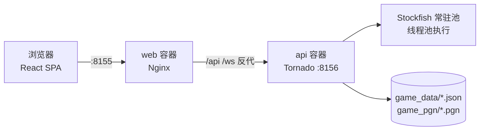

# z_chess · 国际象棋 AI 对弈与分析

React SPA + Tornado API + Stockfish 引擎池。前端与后端**彻底解耦**：前端是自包含的静态产物，
后端只提供 REST 与 WebSocket，两者通过同源反向代理拼装。

| 层 | 技术 | 说明 |
|---|---|---|
| 前端 | React 18 + Vite 6 + react-router 7 | 产物自包含于 `web/dist`，不再混入后端目录 |
| UI | ECharts 6 | 优势变化曲线 |
| 客户端棋规 | chess.js 1.4 | 仅 PGN 复盘页使用（纯前端，零后端依赖） |
| 后端 | Python 3 + Tornado 6.5 | 异步 handler，仅 API + WebSocket |
| 服务端棋规 | python-chess | 棋盘、合法着、PGN 读写 |
| AI 引擎 | Stockfish（UCI 常驻进程池） | 线程池卸载，IOLoop 永不阻塞 |
| 持久化 | 文件系统 | 每局一个 JSON，终局导出 PGN |
| 部署 | Nginx + Docker Compose | 双服务：`web`（Nginx 静态 + 反代）与 `api`（Tornado） |

---

## 架构



关键设计：

* **前后端解耦**：改前端只需重新构建 `web/dist`，完全不碰 Python；Nginx（生产）或 Vite dev
  server（开发）承担同样的静态托管 + 反向代理职责，因此开发与生产的行为一致。
* **按对局隔离**：每局棋有独立 `game_id`、独立棋盘、独立锁。多个浏览器同时访问互不干扰，
  一局的请求不会阻塞另一局。`game_id` 存在浏览器 localStorage 中，刷新页面仍是同一局。
* **引擎不阻塞服务**：Stockfish 进程常驻（固定池大小 + Hash/Threads 配置），所有 UCI 交互
  都通过线程池执行；分析结果按 FEN 缓存，同一局面只算一次并被所有订阅者共享。
* **两段式实时推送**：走棋后先推状态（微秒级），引擎分析算完再补推 `analysis_update`，
  因此再深的搜索也不会拖慢状态同步。
* **长棋谱分析异步化**：整局 PGN 分析改为「提交任务 → 轮询进度」，可取消，HTTP 请求不再挂几分钟。

---

## 目录结构

```
z_chess/
├── app/                        # 后端（python -m app 启动）
│   ├── server.py               # 路由装配 + 启动/优雅关闭
│   ├── config.py               # 全部配置项（环境变量驱动）
│   ├── engine/                 # 引擎层
│   │   ├── pool.py             # Stockfish 常驻进程池 + 线程池卸载
│   │   ├── analysis.py         # 局面/棋谱分析（白方视角归一化）
│   │   ├── cache.py            # FEN 键 LRU 缓存
│   │   └── jobs.py             # 长棋谱分析任务管理
│   ├── game/                   # 领域层
│   │   ├── models.py           # 单局状态模型
│   │   ├── registry.py         # 多对局注册表（per-game 锁）
│   │   ├── storage.py          # JSON 持久化 + PGN 导出（线程池 I/O）
│   │   ├── hub.py              # WebSocket 订阅与推送中心
│   │   └── service.py          # 业务编排 + 服务端规则校验
│   ├── handlers/               # HTTP / WebSocket 协议适配
│   ├── game_data/              # 对局数据（gitignore）
│   ├── game_pgn/               # 导出的棋谱（gitignore）
│   └── stockfish/              # 本地引擎二进制（gitignore，容器内改用系统包）
├── web/                        # 前端（Vite root）
│   ├── src/{game,game_container,pgn_replay,component,utils,constants}
│   ├── vite.config.js          # outDir=web/dist，dev/preview 均代理 /api 与 /ws
│   └── dist/                   # 构建产物（gitignore）
├── scripts/                    # 编排：dev / build / start / api / smoke_test
├── deploy/nginx.conf           # web 容器使用的 Nginx 配置
├── Dockerfile                  # 多阶段：web-build → web / api
└── docker-compose.yml          # 两个服务 + 数据卷 + 健康检查
```

---

## 快速开始

### 1. 开发（前端热更新，改前端不用重启后端）

```bash
npm install && pip install -r requirements.txt
npm run dev            # Web: http://localhost:5173   API: http://localhost:8156
```

Vite dev server 代理 `/api` 与 `/ws` 到后端，前端改动 HMR 即时生效，
**无需重新构建、无需重新集成、无需重启 Tornado**。

### 2. 本地"生产态"（构建产物 + 静态托管 + 代理）

```bash
npm run start          # Web: http://localhost:4173   API: http://localhost:8156
```

### 3. Docker（推荐的生产部署）

```bash
npm run docker:up      # 等价于 docker compose up -d --build
# Web:  http://localhost:8155      API 仅在容器网络内暴露
npm run docker:logs
npm run docker:down
```

### 引擎说明

后端按以下顺序自动定位 Stockfish：`STOCKFISH_PATH` 环境变量 → `PATH` 中的 `stockfish`
→ 仓库内 `app/stockfish/` 下的可执行文件。容器镜像通过系统包安装 Stockfish 并设置
`STOCKFISH_PATH`，因此不需要把平台相关的二进制放进镜像。引擎不可用时服务**仍可启动**，
`/api/health` 会报告 `degraded` 并说明原因，AI 与分析的接口返回 503。

---

## 常用命令

| 命令 | 作用 |
|---|---|
| `npm run dev` | 后端 + Vite dev（开发热更新） |
| `npm run dev:api` / `npm run dev:web` | 单独启动其中一端 |
| `npm run build` | 只构建前端 → `web/dist` |
| `npm run lint` | ESLint（Hooks 规则 + 未使用变量） |
| `npm run preview` | 托管已构建产物（含代理） |
| `npm run start` | 构建 + 托管 + 后端（本地生产态） |
| `npm run test:smoke <api-url> [web-url]` | 端到端验收测试 |
| `npm run docker:up` / `docker:down` / `docker:logs` | 容器编排 |

---

## API

REST 全部按资源组织（无状态、按 `game_id` 分资源）：

| 方法 | 路径 | 说明 |
|---|---|---|
| GET | `/api/health` | 引擎池/任务/缓存/存储状态（容器 healthcheck 使用） |
| GET | `/api/games` | 历史对局摘要列表 |
| POST | `/api/games` | 新建一局（body: `mode` / `player_color` / `ai_level`） |
| GET | `/api/games/{id}` | 单局完整状态 |
| POST | `/api/games/{id}/move` | 玩家走棋（body: `move` = UCI） |
| POST | `/api/games/{id}/ai` | 请求 AI 走棋（body: `ai_level` 可选） |
| POST | `/api/games/{id}/undo` | 悔棋（body: `plies`，默认 1，AI 模式常用 2） |
| POST | `/api/games/{id}/mode` | 设置模式/执子/AI 等级（不重置对局） |
| POST | `/api/games/{id}/reset` | 归档当前局并开新局（可同时切换模式） |
| GET | `/api/games/{id}/analysis` | 当前局面分析（带缓存，`?depth=` 可选） |
| POST | `/api/analysis/jobs` | 提交整局 PGN 分析任务（body: `pgn_text` / `depth`） |
| GET | `/api/analysis/jobs/{job_id}` | 查询任务进度与结果 |
| DELETE | `/api/analysis/jobs/{job_id}` | 取消任务 |

状态快照统一形状：

```json
{
  "board_state": { "fen": "...", "legal_moves": ["..."], "turn": "white",
                   "is_check": false, "is_checkmate": false, "is_stalemate": false,
                   "is_game_over": false, "game_result": "ongoing", "last_move": {...} },
  "game_info":   { "game_id": "...", "mode": "ai", "player_color": "white",
                   "ai_level": "normal", "result": "ongoing", "version": 3 },
  "move_history": [ { "move_number": 1, "color": "white", "move": "e2e4",
                      "san": "e4", "type": "human", "timestamp": "..." } ],
  "statistics":  { "total_moves": 1, "white_moves": 1, "black_moves": 0,
                   "ai_moves": 0, "human_moves": 1 }
}
```

所有**评分统一为白方视角**：`advantage_score > 0` 表示白方占优，`mate_in` 为正值表示白方将杀步数。

### WebSocket

`/ws/game?game_id=<id>`（缺省则在内存中新开一局并通过 `hello` 返回 `game_id`）

服务端 → 客户端：

| type | 时机 |
|---|---|
| `hello` | 连接建立（含 `game_id`、`adopted`、当前状态） |
| `status_update` | 任何状态变化（走棋/悔棋/重置/模式切换） |
| `analysis_update` | 该局面的引擎分析结果（同一局面算一次，所有订阅者共享） |
| `error` / `pong` | 错误与心跳应答 |

客户端 → 服务端：`{"action":"refresh"}`、`{"action":"subscribe","game_id":"..."}`、`{"action":"ping"}`

安全：WebSocket 默认只接受**同源**连接（跨源返回 403）；仅在设置 `CHESS_CORS_ORIGINS`
时才额外允许白名单来源（开发/预览脚本会自动带上前端端口）。REST 的 CORS 默认关闭。

---

## 环境变量

| 变量 | 默认 | 说明 |
|---|---|---|
| `PORT` | `8156` | API 端口 |
| `SERVER_HOST` | `0.0.0.0` | 监听地址 |
| `STOCKFISH_PATH` | 自动探测 | 引擎可执行文件路径 |
| `ENGINE_POOL_SIZE` | `2` | 常驻引擎实例数 |
| `ENGINE_HASH_MB` / `ENGINE_THREADS` | `64` / `1` | 每个引擎的 UCI 选项 |
| `ANALYSIS_DEPTH` | `14` | 单局面分析深度 |
| `BROADCAST_ANALYSIS_DEPTH` | `12` | 实时推送的分析深度 |
| `PGN_ANALYSIS_DEPTH` | `12` | 长棋谱任务默认深度 |
| `ANALYSIS_CACHE_SIZE` | `512` | 局面分析缓存条目数 |
| `ANALYSIS_JOBS_MAX` | `2` | 同时运行的长棋谱任务数 |
| `CHESS_DATA_DIR` / `CHESS_PGN_DIR` | `app/game_data` / `app/game_pgn` | 数据目录 |
| `CHESS_CORS_ORIGINS` | 空（仅同源） | 允许的跨源来源，逗号分隔 |
| `CHESS_DEBUG` | `false` | Tornado debug 模式 |
| `VITE_API_BASE_URL` | 空（同源） | 仅当前后端分域名时设置 |

---

## 验收测试

`scripts/smoke_test.py` 覆盖 9 组、50+ 项断言（多对局隔离、服务端规则校验、悔棋/重置/历史、
WebSocket 两段式推送、**引擎计算不阻塞 IOLoop**、长棋谱任务进度与取消、终局落盘与 PGN 导出、
以及经代理的完整链路）：

```bash
# 起一个隔离的实例
PORT=8199 CHESS_DATA_DIR=/tmp/zc/data CHESS_PGN_DIR=/tmp/zc/pgn \
  PYTHONPATH=. python3 -m app &
python3 scripts/smoke_test.py http://127.0.0.1:8199

# 追加第二个参数即可同时验证「经 Vite preview / Nginx 代理」的链路
python3 scripts/smoke_test.py http://127.0.0.1:8199 http://localhost:4173
```

---

## 数据

* 每局一个 `app/game_data/<game_id>.json`（含走法、模式、结果、时间戳）。
* 终局时自动导出 `app/game_pgn/<时间>_<短id>.pgn`，文件名不含冒号（跨平台安全）。
* 旧版本（3.0 之前）的 JSON 数据可直接加载：棋盘由走法回放重建，缺 `san` 时前端回退显示 UCI。

## 更多

* 在线示例：<https://dipengxu.life/toy/chess.html>
* `image/chess-tech-structure-img.png` 为重构前的架构图，当前架构以上文 mermaid 图为准。
